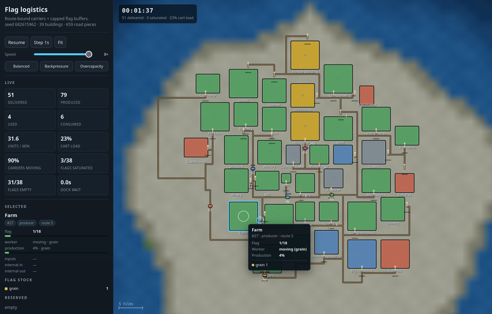
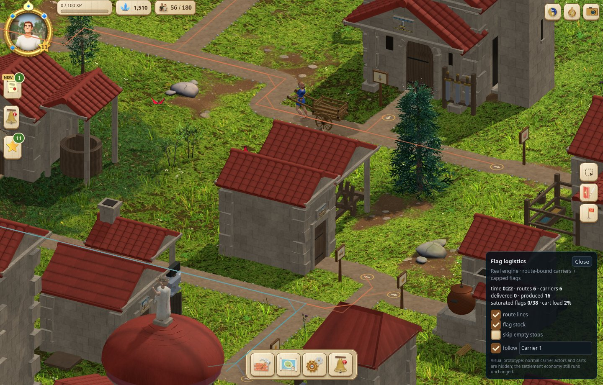

# Route-bound flag logistics — demo



The full review handoff for another AI/engineer is in
[`docs/decisions/07-movement-and-traffic.md`](../../../docs/decisions/07-movement-and-traffic.md).

## Real-engine demo



There is also a **real-engine visual prototype** that boots the actual game client on the developed
island. It uses the real terrain, roads, buildings, workers and handcart models; the normal carrier
actors and carts are hidden, and the flag simulation drives route carriers and flag porters instead.
The real settlement economy still runs unchanged behind it.

From `island-of-settlers-client/`:

```bash
npm run dev
```

Open <http://localhost:5173/?flagdemo=1&skipLogin=1>.

- The camera follows carrier 1 by default; use the carrier dropdown in the bottom-right panel to follow another.
- Each good is loaded/unloaded **one unit at a time**, with a per-item pickup/putdown animation and the cart load changing per unit.
- “Skip empty stops” enables the smart-skip prototype (see the benchmark below).
- “Route lines” and “Flag stock” toggle the overlay.
- The panel is bottom-right; the normal game UI remains usable.

The demo fixture files are `island-of-settlers-client/public/demo/continued-0.json` and
`island-of-settlers-client/public/demo/flag-island.json`.

## Standalone demo

A standalone browser demo of the proposed logistics model:

- every building gets a **flag** at its road access point;
- the **building worker** shuttles goods between the building and its flag;
- **carriers own fixed circuits** (route-bound) instead of taking globally dispatched jobs;
- every flag is a **capped buffer** (total and per-ware capacity);
- the headquarters is the hub, with a limited number of docks;
- the **39 buildings** from the developed island fixture are placed on the real road network
  (39 unique types); the debug catalog exposes all **52** buildable types.

The demo is intentionally self-contained: no game runtime, no build step, no external packages.

## Run it

From this folder:

```bash
python3 -m http.server 5199
```

Open <http://localhost:5199/>.

Or, from the `island-of-settlers-client/` folder, use the normal Vite dev server:

```bash
npm run dev
```

and open <http://localhost:5173/demos/route-logistics/>.

## Test it

```bash
node --test test/sim.test.mjs
```

The simulation tests cover route coverage, capped-buffer invariants, ware conservation,
determinism, production/delivery, backpressure, runtime building add/remove, extra carriers,
state export, and route rebuilding.

Browser smoke test (needs Playwright Firefox, which is already in `island-of-settlers-client/node_modules`):

```bash
npm run test:browser
```

## Data

`data/island.json` was exported from
`resources/project-reviews/client-supported-offline-20261020-prey-fixed/continued-0.json`
(seed `682615962`, 39 buildings, 659 half-tile road pieces). It contains:

- real building placements, names, production rules and the HQ inventory;
- the real road graph;
- a 128×128 terrain height/water preview;
- the full building catalog so the debug panel can place any type.

Regenerate it with:

```bash
cd client
npx tsx demos/route-logistics/tools/export-island.ts \
  ../resources/project-reviews/client-supported-offline-20261020-prey-fixed/continued-0.json \
  demos/route-logistics/data/island.json
```

## What to look at

- **Routes** in the sidebar: each carrier owns a circuit. Click a route to highlight its road path.
- **Selected**: click a building or carrier for its flag stock, worker state, production progress,
  cargo and next stop.
- **Live**: delivered units, production, cart utilization, moving share, saturated/empty flags,
  dock wait. A saturated flag is one where the total cap or a per-ware cap is reached.
- **Debug**: place any of the 39 building types, add carriers, remove a selected building,
  rebuild routes, export the current state, and change caps/production speed live.
- **Presets**:
  - *Balanced* — 6 routes, 18/6 flag caps, 1.5× production.
  - *Backpressure* — 3 routes, small flags, 3× production; producer flags fill and stall.
  - *Overcapacity* — 8 routes, large flags, low production; most flags stay empty.

## Default findings on this island

At the balanced preset, 6 carriers keep up with the simplified economy:

- carriers are moving about 90% of the time;
- carts are only ~20–30% full on average;
- 30+ of 38 non-hub flags are empty at any moment;
- 3–7 flags are saturated, usually producer outputs whose building output buffer is also full;
- the bottleneck is production/input chains, not carrier throughput.

That is the useful result for the Phase B discussion: a route-bound carrier does not need a global
dispatch decision, and its next leg is predictable. It also shows that **capped flags create visible
backpressure**: when a producer flag is saturated, its worker stops depositing and the building's
output buffer fills, so production pauses instead of disappearing into an unlimited buffer.

## Cap benchmark

The three debug caps — flag total capacity, per-ware capacity and cart capacity — were benchmarked at
6 simulated hours per run on this island. The generated matrix is in
[`benchmarks/cap-matrix.md`](./benchmarks/cap-matrix.md), with candidate combinations and the
1-farm-versus-5-farms check in [`benchmarks/recommendations.md`](./benchmarks/recommendations.md).
The smart-skip prototype is in [`benchmarks/smart-skip.json`](./benchmarks/smart-skip.json):
skip-service halves the number of serviced stops, but wall time stays flat and throughput can fall.
The 9-island offline estimate is in [`benchmarks/offline-9-islands.json`](./benchmarks/offline-9-islands.json);
regenerate the matrix with:

```bash
npm run bench
```

The measured spread is small: the per-step cost is dominated by the fixed building/worker and
carrier movement work, while the caps mainly change event frequency and backpressure. The matrix
includes both wall-clock time and workload counters (delivered, produced, loaded, services) so the
direction of each change is visible.

## Validation run

The 17 simulation tests pass. A 6-hour simulated run at 0.2 s steps completes in about
0.5 s of Node time (this is a simplified model, not a game benchmark), with ware conservation
still exact. At the end of that run, 13 of the 38 non-hub flags were saturated — typically a
producer's output at its per-ware cap, with the building's internal output buffer full behind it.
That is the intended backpressure behavior.

## Implementation notes

- `src/sim.js` is dependency-free and deterministic (no `Math.random`). It is the same module used
  by the browser and by `node --test`.
- `src/render.js` draws the terrain, roads, buildings, flags, routes, carriers and workers on a
  2D canvas with pan/zoom.
- `src/main.js` is the UI and fixed-step loop (10 Hz simulation steps, rendered every frame).
- The simulation is fixed-step for the demo. The state is deliberately explicit (flag stock,
  reservations, carrier leg/cargo, worker mode) so it could be driven by an event queue instead.
- Production uses the real building rules/cycle lengths, but consumer demand and the surplus sink
  at the HQ are simplified. This is a logistics sandbox, not a full game economy.

## Limitations

- The demo does not load or save the game's runtime; it only uses the exported layout.
- Worker trips are schematic (one unit per trip).
- The HQ acts as the single hub. Storehouses and the harbour are ordinary stops in this demo.
- The terrain preview is a 128×128 downsample, not the full game renderer.
- The demo does not claim to reproduce the game's exact economy or its door/courtyard behavior.
